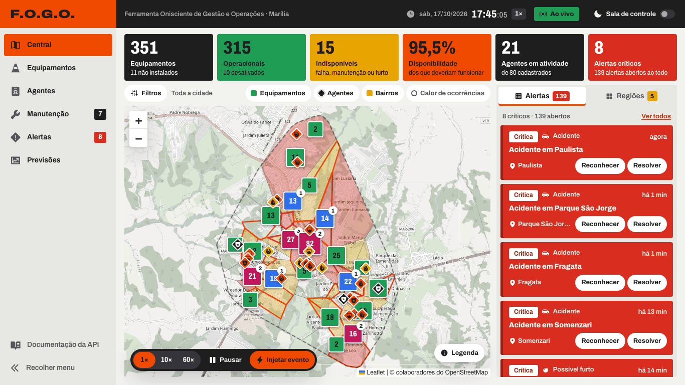
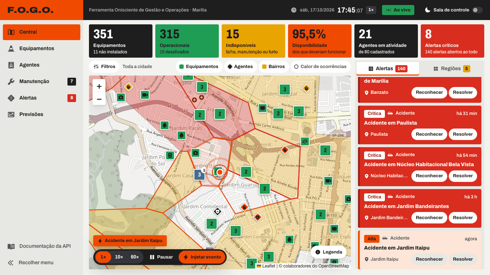
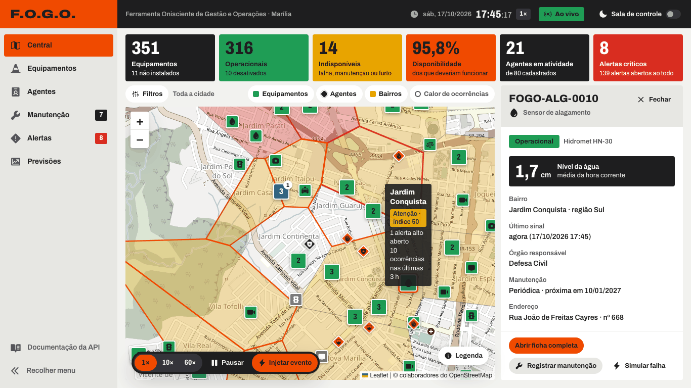
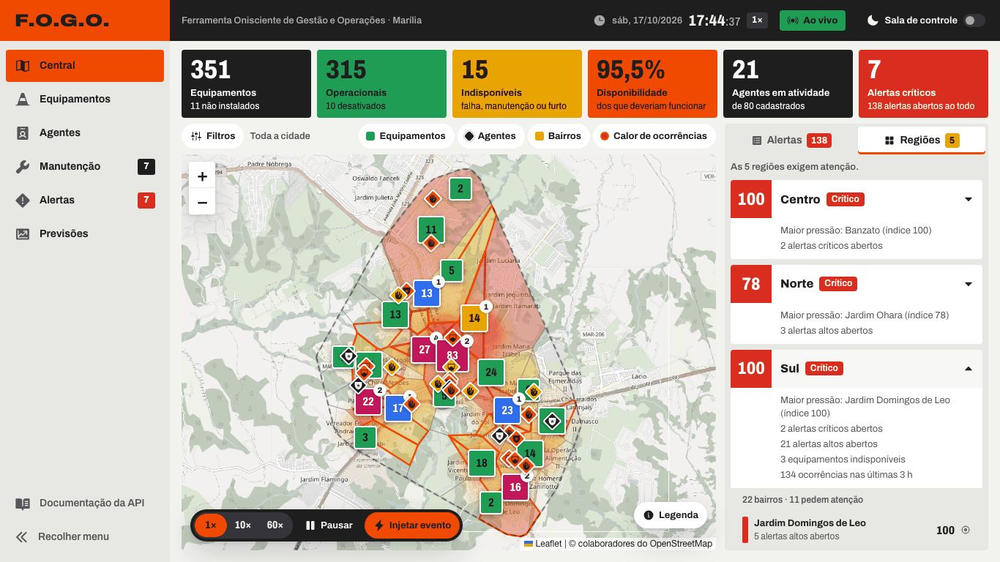
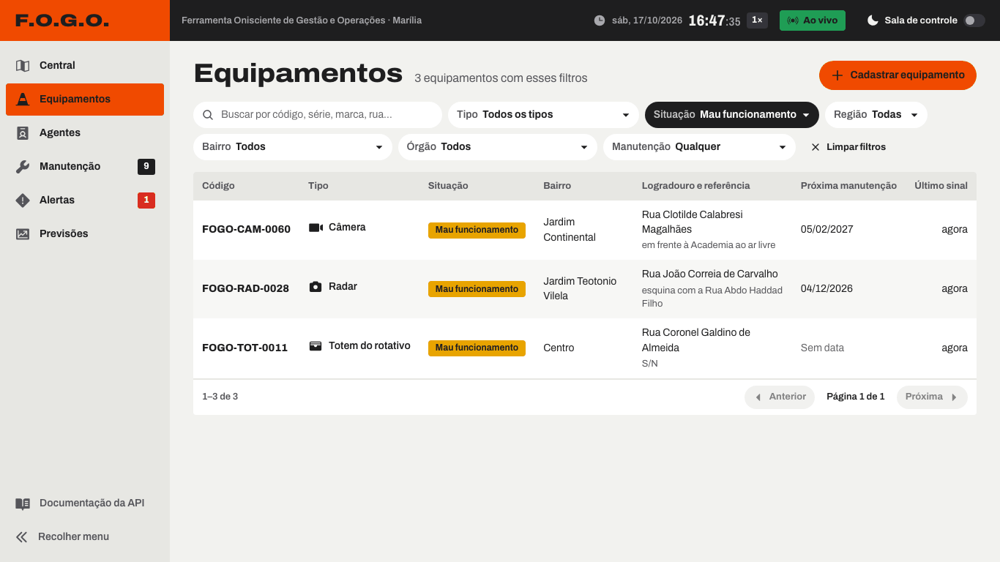
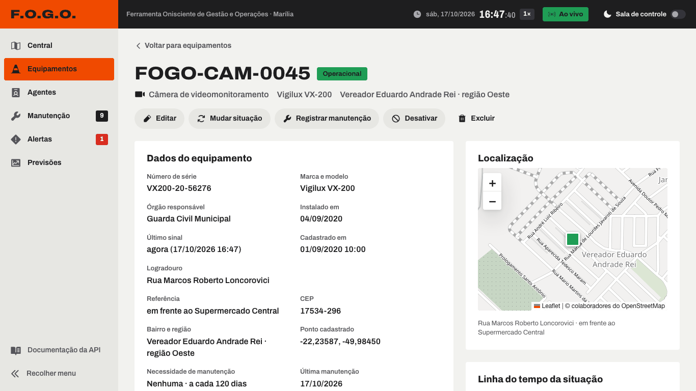
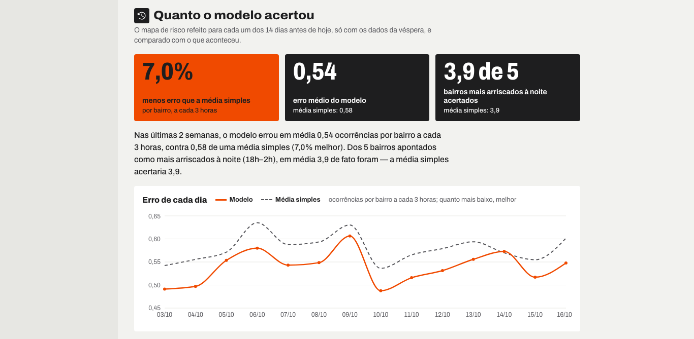
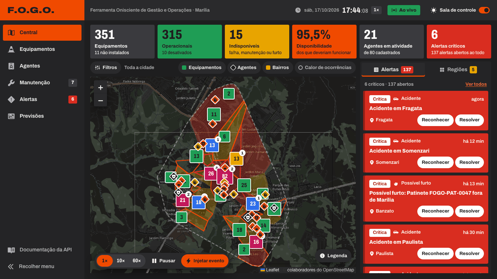
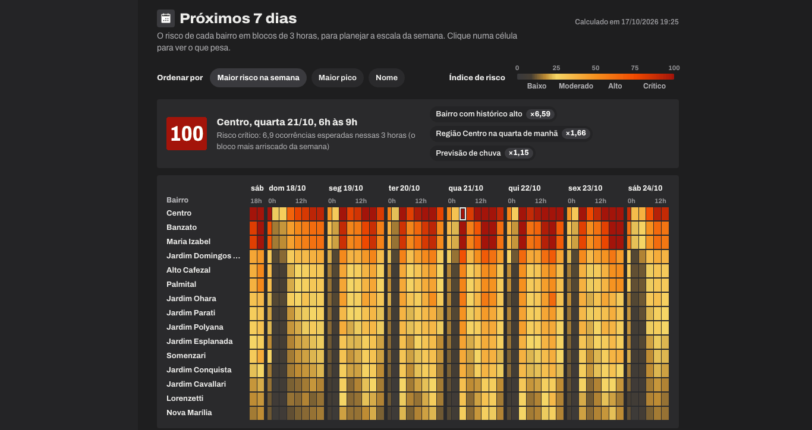

# F.O.G.O. — Ferramenta Onisciente de Gestão e Operações

Sistema web de monitoramento de equipamentos de trânsito e segurança de **Marília-SP**, feito para a etapa bônus do **DSIN Coder Challenge 2026**. Tudo em português do Brasil, sem serviço externo obrigatório.

São três partes, num único sistema:

1. **Inventário Inteligente da Cidade** — cadastro de 13 tipos de equipamento IoT (radares, câmeras, semáforos, patinetes…) e de agentes (trânsito, guarda municipal, PM), com busca, filtros, ficha, mapa e API documentada.
2. **Central de Operações** — mapa ao vivo com equipamentos e agentes se mexendo, seis indicadores, feed de alertas em tempo real e situação de cada região; dá para acelerar a simulação e injetar acidente, furto, falha ou alagamento.
3. **Cidade Preditiva** — risco por bairro e hora (24 h e 7 dias), reforço de agentes, equipamentos com chance de falhar, anomalias e tendências; cada previsão diz o que prevê, com quais dados, como ajuda e **quão certa ela foi no passado**.



## Como rodar em 1 minuto

**Com Node.js 22.14 ou mais novo** (recomendado: a LTS atual). Confira com `node -v`: numa versão mais velha, o `npm start` para logo no começo com uma mensagem em português que sugere instalar a LTS ou usar o Docker (o `better-sqlite3` 13 traz o binário pronto para a Node-API 10, que chegou no Node 22.14).

```bash
npm install && npm start
```

Abra **http://localhost:3333**. Na primeira vez o sistema compila a interface e cria sozinho o banco `data/fogo.db` com a cidade inteira (poucos segundos: 3,6 s numa medição de 17/10/2026). Não há banco, chave ou conta para configurar.

**Com Docker** (se preferir não instalar o Node):

```bash
docker compose up --build
```

O banco fica num volume (`fogo-dados`): sobrevive a `docker compose down`; `docker compose down -v` recomeça do zero.

Porta ocupada? O sistema avisa e sugere a próxima. Para escolher a porta ou outro arquivo de banco:

| Terminal | Outra porta | Outro arquivo de banco |
|---|---|---|
| macOS / Linux | `PORT=3334 npm start` | `FOGO_DB=./data/outro.db npm start` |
| Windows (PowerShell) | `$env:PORT=3334; npm start` | `$env:FOGO_DB="./data/outro.db"; npm start` |
| Windows (cmd) | `set PORT=3334&& npm start` | `set FOGO_DB=./data/outro.db&& npm start` |

No PowerShell e no cmd a variável vale até fechar aquele terminal.

> Só os **blocos do mapa** (OpenStreetMap) precisam de internet. Sem ela, o mapa fica sem o fundo de ruas, mas os pontos, polígonos e o resto continuam funcionando.

## O que olhar primeiro (roteiro de 2 minutos)

1. **Central** (`/`): seis placas de cor cheia, mapa com equipamentos agrupados por situação, agentes deslizando, bairros pintados pelo índice de atenção e o feed de alertas à direita.
2. Barra no rodapé do mapa: com a velocidade em **1×**, clique em **Injetar evento → Acidente**. Na hora aparece o alerta **crítico** (o acidente injetado usa sempre a gravidade máxima), o agente mais próximo é despachado ao local e o índice do bairro sobe 29 pontos (alerta crítico + ocorrência; na medição de 17/10/2026 o bairro passou de normal (24) para atenção (53)). Em 1× a ocorrência dura alguns minutos; quando termina, o alerta se resolve sozinho (fica registrado como resolução automática).
3. Agora clique em **60×**: agentes e patinetes andam mais depressa e chegam ocorrências e alertas sem parar. A 60× tudo dura segundos, inclusive um acidente injetado. Mesmo depois de 3 minutos assim, as regiões continuam distintas (17/10/2026: Centro 65, crítico; Sul 46, Oeste 38 e Norte 30, atenção; Leste 8, normal), porque o índice mede a cidade no ritmo real (veja "Decisões e limitações").
4. Clique num marcador: a **ficha lateral** abre com situação, manutenção e ações; "Abrir ficha completa" mostra a linha do tempo, o gráfico de telemetria e os alertas.
5. **Previsões** (`/previsoes`): comece pelo "Resumo do dia" e role até **"Quanto acertou"**: é o teste retroativo, onde a previsão feita na véspera é comparada com o que de fato aconteceu.
6. Interruptor **Sala de controle** (topo): modo escuro grafite, só por escolha do usuário.

## Telas

| | |
|---|---|
|  **Acidente injetado**: alerta, agente despachado e bairro em atenção |  **Ficha do equipamento** sem sair do mapa |
|  **Regiões**: quem opera normal e quem exige atenção |  **Inventário** com busca e filtros |
|  **Ficha completa**: situação, manutenção, telemetria |  **Teste retroativo** da previsão |
|  **Sala de controle** (modo escuro) |  **Risco dos próximos 7 dias** |

Tela de Previsões completa: [docs/telas/previsoes-topo.png](docs/telas/previsoes-topo.png).

## Modo Campo (o celular do agente)

Abra **http://localhost:3333/campo** no celular (ou no navegador em 390 px), ou use "Modo Campo" no menu. É a outra ponta da Central: o gestor vê o agente no mapa, e o agente conta daqui o que acontece na rua.

- **Quem sou eu**: o agente escolhe o próprio nome uma vez (sem login, como o resto do sistema); a escolha fica guardada no aparelho.
- **Minha situação** em quatro botões grandes (em serviço, em ocorrência, pausa, fora de serviço), pela mesma rota da tela de Agentes.
- **Despacho**: a ocorrência para a qual a Central o mandou, com rua, bairro e distância; **"Cheguei ao local"** e depois **"Concluir ocorrência"**, que encerra a ocorrência, fecha o alerta dela e o devolve para "em serviço".
- **Perto de mim**: os 5 equipamentos mais próximos, com a situação de cada um; **"Relatar problema"** (mau funcionamento, furtado ou vandalizado, com observação) muda a situação e abre o alerta na Central pelo mesmo caminho da tela do gestor.
- **Ao vivo**: um despacho novo chega pelo `/api/stream`, com destaque na tela e vibração quando o aparelho permite.

Para ver o ciclo inteiro, deixe a Central e o `/campo` lado a lado: o simulador despacha agentes o tempo todo, e um acidente injetado vai para o agente de trânsito ou PM em serviço mais próximo. No celular de quem foi despachado, o aviso aparece na hora; "Concluir ocorrência" faz o alerta sumir da Central.

## Arquitetura

```
 Simulador (no próprio processo)           Dispositivo real (curl, ESP32…)
        │  leituras de telemetria                    │
        └──────────────► POST /api/telemetria ◄──────┘     ← a mesma porta de entrada
                                 │
                        ingestão (valida, grava a hora, atualiza posição)
                                 │
              ┌──────────────────┴──────────────────┐
      detecção de anomalias                   motor de alertas
   (leitura × normal do equipamento)   (abre, repete, resolve; sem duplicar)
              └──────────────────┬──────────────────┘
                                 │
                   barramento de eventos (agrupa posições)
                                 │  Server-Sent Events: GET /api/stream
                                 ▼
                 Interface React (mapa Leaflet, feed, placas)

 SQLite (data/fogo.db)  ──►  Previsões: risco, reforço, falhas, tendências
 (60 dias de histórico        calculadas só sobre o HISTÓRICO e comparadas com o passado
  + o que chega ao vivo)      (o que a simulação gera ao vivo fica de fora)
```

| Camada | Tecnologia |
|---|---|
| Servidor | Node 22, TypeScript estrito, Fastify 5, zod, Swagger (`/api/docs`) |
| Banco | SQLite (`better-sqlite3`), arquivo único, SQL puro |
| Interface | React 19, Vite, TanStack Query, React Router, Leaflet (+ agrupamento e calor), Recharts |
| Testes | Vitest (servidor, regras, previsões, interface) e Playwright (fumaça) |

Código compartilhado entre servidor e interface fica em `shared/` (tipos, regras de classificação, validação, formatação pt-BR). O mapa de pastas está em [docs/GUIA-DO-TIME.md](docs/GUIA-DO-TIME.md).

## Dicionário de dados (resumo)

| Entidade | O que guarda |
|---|---|
| **equipamentos** | código legível (`FOGO-RAD-0007`), tipo (13), nº de série único, marca, modelo, órgão, **situação** (`operacional`, `mau_funcionamento`, `em_manutencao`, `desativado`, `furtado`, `nao_instalado`), endereço (CEP, logradouro, referência, bairro, cidade/UF), latitude/longitude, posição atual (móveis), último sinal, manutenção (necessidade, periodicidade, última e próxima data), características do tipo (JSON validado) |
| **historico_situacao** | cada mudança de situação, com motivo, data e origem (`historico` da semente ou `ao_vivo`, do simulador e da tela) |
| **agentes** | nome, matrícula, categoria, órgão, situação (`em_servico`, `em_ocorrencia`, `pausa`, `fora_de_servico`), turno, base, posição, equipamento vinculado |
| **bairros** | 65 bairros reais de Marília (OpenStreetMap): região (Centro/Norte/Sul/Leste/Oeste), centro e polígono |
| **ocorrencias** | acidente, congestionamento, infração, furto/vandalismo, veículo quebrado, alagamento, segurança; gravidade, local, início/fim, origem (`historico`, `tempo_real`, `injetado`), agente e o peso no índice das regiões |
| **telemetria_hora** | uma linha por equipamento e hora, com as métricas do tipo (fluxo, bateria, sinal…) |
| **manutencoes** | ordens (preventiva/corretiva), previstas e concluídas |
| **alertas** | criticidade (crítica, alta, média, baixa), tipo, explicação, reconhecido/resolvido (manual ou automático) |
| **clima_dia** | chuva que caiu e a previsão do tempo da véspera (as previsões usam a previsão, nunca a chuva que caiu no dia previsto) |

Datas no banco: texto ISO 8601 em UTC. Na tela: `dd/mm/aaaa HH:mm` no fuso de São Paulo. Toda coordenada cadastrada precisa cair dentro do limite do município.

## Como cada previsão funciona

Fórmula em uma linha e um exemplo. Os exemplos saíram de um banco novo criado em 17/10/2026 às 20h53 (sábado); num outro dia os números mudam um pouco, porque o histórico de 60 dias termina na hora em que o banco é criado. Os detalhes passo a passo estão no [guia do time](docs/GUIA-DO-TIME.md).

- **Risco por bairro e hora** — `taxa = base do bairro × perfil da região naquele dia da semana e hora × chuva prevista do dia × tendência da cidade`; o índice (0 a 100) compara a taxa com o percentil 99 das próximas 24 h. Ex.: bairro Centro no sábado às 22 h: 1,235 × 1,89 (região Centro, sábado 22 h) × 1 (sem chuva prevista) × 0,98 = 2,30 ocorrências/h → índice 100 (crítico); no domingo às 3 h: 1,235 × 0,38 × 1 × 0,98 = 0,46 → 0,46 ÷ 1,32 (p99) = índice 35 (moderado).
- **Reforço de agentes** — `carga por agente = ocorrências esperadas na região no turno ÷ agentes escalados`; move-se 1 agente por vez da região mais folgada para a mais sobrecarregada, enquanto a maior carga passar 20% da média da cidade. Ex.: noite de sábado (22h às 6h), região Centro com 31,8 ocorrências esperadas para 5 agentes = 6,4 por agente, contra 2,0 na Zona Leste → "mande 1 agente da Zona Leste para a região Centro" (Centro cai para 5,3).
- **Chance de falha em 7 dias** — `λ = taxa do tipo × fator do modelo × (1 + anos/5) × atraso da manutenção × quedas de sinal recentes; chance = 1 − e^(−7λ)`. Ex.: a câmera FOGO-CAM-0059 (Vigilux VX-200, 7,6 anos, 37 horas com sinal fraco nas últimas 72 h) aparece em primeiro, com 99%. Pela fórmula, λ = 0,02 por dia dá 1 − e^(−0,14) = 13%.
- **Anomalias em tempo real** — compara cada leitura com a média e o desvio **do mesmo equipamento, na mesma hora e tipo de dia**; vira alerta quando |z| ≥ 3 (com confirmação em leituras seguidas). Ex.: radar com fluxo ≈ 0 no horário de pico.
- **Tendências** — disponibilidade por tipo (30 dias + reta de mínimos quadrados por 7 dias), uso de patinetes por bairro e falhas por 100 equipamentos de cada marca/modelo. Ex.: o modelo ruim (Vigilux VX-200) tem 243 falhas por 100 câmeras contra 66 do modelo mediano.

### Quão certas elas são (teste retroativo)

A tela de Previsões **refaz a previsão como se fosse a véspera, 14 dias seguidos**, e compara com o que aconteceu. Cada dia é previsto só com os dados até a meia-noite anterior, e a chuva do dia entra pela **previsão do tempo guardada** (que às vezes erra), nunca pela chuva que caiu. Todos os números abaixo são de uma mesma medição: banco novo, 17/10/2026 às 20h53 (dias avaliados: 03/10 a 16/10). A tela recalcula a cada dia, então eles variam um pouco.

| Medida | Resultado |
|---|---|
| Erro por bairro em blocos de 3 h, contra repetir a média de cada bairro | 0,54 × 0,58 ocorrência: **7,0% menor** |
| Dos 5 bairros apontados como mais arriscados à noite (18h–2h), quantos acertou | **3,9 de 5**, o mesmo que a média simples (3,9): aqui o modelo empata |
| Falhas de equipamento na última semana | **32 previstas** (31,6) **× 40 ocorridas** |
| Os 10% de equipamentos apontados como mais arriscados | concentraram **28%** das falhas da semana (ao acaso seriam 10%) |
| Projeção de disponibilidade em 7 dias | erra 4,9 p.p., **pior** que repetir a média de 30 dias (4,1) e o último valor (4,4): a tela avisa "use para ver a direção" |

Nessa mesma medição, 3 minutos a 60× geraram 415 ocorrências e 68 falhas ao vivo (o histórico inteiro de 60 dias tem 286 falhas) e **nenhum desses números mudou**: as previsões só aprendem com o histórico.

**Por que o ganho de ~7% e não 30%?** Por bairro e hora quase sempre há 0 ou 1 ocorrência, então boa parte do erro é pura sorte. Mesmo conhecendo as taxas verdadeiras usadas para gerar os dados, o máximo de melhora possível seria cerca de 10% (cálculo com o próprio gerador); o modelo chega a cerca de 70% desse teto. Antes de trocarmos a chuva observada pela previsão guardada, a mesma tela mostrava ~8%: a diferença é o preço de não deixar o dia previsto vazar para a previsão. Preferimos mostrar o número honesto a escolher uma métrica que o inflasse.

## Boletim do dia (para a reunião)

Abra **http://localhost:3333/boletim** (ou "Boletim do dia" no menu): a cidade numa folha A4, pronta para **Imprimir / Salvar PDF** (o botão abre a impressão do navegador; na folha não sai o menu nem os botões).

- Cabeçalho com data, hora de emissão e as ações do **resumo do dia** (Previsões).
- Os **6 indicadores** da Central e a **situação das 5 regiões** (normal, atenção, crítico).
- Os **5 bairros de maior risco** nas próximas 24 h, com a hora de pico e o porquê (os mesmos fatores da tela de Previsões).
- **Alertas críticos abertos**, **manutenções vencidas ou dos próximos 7 dias**, os **10 equipamentos com maior chance de falha** e a **recomendação de reforço de agentes**.
- **Exportar CSV**: inventário de equipamentos, agentes e manutenções pendentes. O arquivo é gerado no próprio navegador com `;` como separador, vírgula decimal, datas dd/mm/aaaa e BOM UTF-8, para abrir direto no Excel em português com os acentos certos.

Tudo vem das rotas que as telas já usam (`/api/central/*`, `/api/alertas`, `/api/previsoes/*`, `/api/manutencao/painel`): o boletim não calcula número novo, só recorta e escreve.

## API

Documentação interativa (Swagger): **http://localhost:3333/api/docs**. Principais rotas:

| Grupo | Rotas |
|---|---|
| Inventário | `GET/POST /api/equipamentos`, `GET/PUT/DELETE /api/equipamentos/:id`, `PATCH …/situacao`, `POST …/manutencoes`, `GET …/telemetria`; `GET/POST /api/agentes`, `GET/PUT/DELETE /api/agentes/:id`, `PATCH …/situacao`; `GET /api/bairros`, `GET /api/tipos-equipamento` (com as métricas de telemetria de cada tipo) |
| Central | `GET /api/central/{indicadores,mapa,regioes,ocorrencias}`, `GET /api/alertas`, `PATCH /api/alertas/:id/{reconhecer,resolver}`, `GET /api/manutencao/painel` |
| Tempo real | `POST /api/telemetria`, `GET /api/stream` (SSE), `GET/PATCH /api/simulacao`, `POST /api/simulacao/eventos` |
| Previsões | `GET /api/previsoes/{risco,backtest,reforco,falhas,tendencias,resumo}` (`backtest` = o teste retroativo do risco) |
| Modo Campo | `GET /api/campo/agentes/:id/{despacho,equipamentos-proximos}`, `POST /api/campo/agentes/:id/despachos/:ocorrenciaId/{chegada,conclusao}`, `POST /api/campo/agentes/:id/reportes` |
| Saúde | `GET /api/saude` |

**Enviando uma leitura como se fosse um equipamento.** Cada equipamento tem um token (gerado na semente, nunca devolvido pela API). Para pegar o de um equipamento do **seu banco local** e mandar uma leitura (com o servidor ligado):

macOS / Linux:

```bash
TOKEN=$(npm run -s token -- FOGO-RAD-0001)

curl -X POST http://localhost:3333/api/telemetria \
  -H "content-type: application/json" \
  -H "x-dispositivo-token: $TOKEN" \
  -d '{"codigo":"FOGO-RAD-0001","metricas":{"fluxo":412,"velocidadeMedia":38.5,"infracoes":3}}'
# → 202 {"aceita":true}
```

Windows (PowerShell):

```powershell
$token = npx tsx scripts/token.ts FOGO-RAD-0001   # o mesmo que "npm run token", sem o "--" que o PowerShell pode engolir

Invoke-RestMethod -Method Post -Uri http://localhost:3333/api/telemetria `
  -ContentType "application/json" -Headers @{ "x-dispositivo-token" = $token } `
  -Body '{"codigo":"FOGO-RAD-0001","metricas":{"fluxo":412,"velocidadeMedia":38.5,"infracoes":3}}'
# → aceita: True
```

As métricas aceitas dependem do tipo (ex.: radar = `fluxo`, `velocidadeMedia`, `infracoes`): a lista completa, com rótulo e unidade, está no campo `metricas` de `GET /api/tipos-equipamento`. Métrica que não existe para o tipo responde `400` dizendo quais valem. Sem token, ou com o token de outro equipamento, a resposta é `401`.

## Testes

```bash
npm test            # Vitest: servidor, regras, previsões e interface (376 testes em 52 arquivos)
npm run typecheck   # TypeScript estrito, servidor e interface
npm run e2e         # Playwright: sobe o app com banco próprio (porta 3399) e confere Central, Previsões e Equipamentos
```

O E2E usa `data/e2e.db` e o apaga ao terminar; não mexe no seu `data/fogo.db`. Na primeira execução do Playwright pode ser preciso `npx playwright install chromium`.

`npm run empacotar` gera `fogo-dsin-coder-challenge.zip` (sem `node_modules`, `dist`, bancos e pastas de trabalho; falha se passar de 50 MB).

## Decisões e limitações (sem maquiagem)

- **Os dados são sintéticos.** Bairros e ruas são reais (OpenStreetMap), mas equipamentos, agentes, ocorrências e 60 dias de telemetria são gerados com semente fixa e **padrões plantados** de propósito (picos de 7–9 h e 17–19 h, sexta/sábado à noite no Centro, chuva com mais acidentes, um modelo de câmera pouco confiável, furtos de patinete em dois bairros). A previsão "redescobre" esses padrões; isso prova que o método funciona, **não** que ele acertaria numa cidade real sem ajuste.
- **O simulador é acelerado de propósito** para a demonstração: ocorrências, falhas e furtos ao vivo acontecem muito mais depressa que na vida real. Por isso as previsões aprendem **só com o histórico**: todas as entradas (ocorrências, falhas, telemetria, mudanças de situação) param no fim do histórico gerado, e as mudanças de situação feitas ao vivo levam a marca `ao_vivo`, então continuam de fora mesmo depois de reiniciar. Eventos injetados também ficam de fora. A lista de "falhas prováveis" mostra os equipamentos em operação **agora**: um equipamento que o simulador consertou volta para a lista.
- **A situação das regiões mede a cidade no ritmo real.** O índice soma 4 pontos por ocorrência das últimas 3 h, mas cada ocorrência gerada ao vivo pesa 1 ÷ (8 × a velocidade em que começou), porque o simulador produz 8 vezes o ritmo real (vezes 10 ou 60); histórico e eventos injetados pesam 1. O painel mostra as duas contas ("192 ocorrências nas últimas 3 h (contam como 6,5 no ritmo real)").
- **Furtos ao vivo só fecham com uma pessoa**: o patinete furtado fica fora da cidade e com alerta crítico até alguém registrar a recuperação (ele volta ao ponto-base e o alerta fecha) ou resolver o alerta. Deixando 60× ligado por muito tempo, esses furtos se acumulam no índice dos bairros.
- A velocidade 10× e 60× multiplica o ritmo de eventos, mas o relógio é o relógio real (nada é gravado no futuro).
- **Se o avaliador abrir dias depois**, o histórico é completado até "agora" ao iniciar (a lacuna é preenchida), então "próximas 24 h" continua valendo. A lacuna não cria falhas novas de equipamento; o simulador ao vivo cria.
- O ganho do risco por bairro é modesto (~7%) e, nos 5 bairros mais arriscados à noite, o modelo empata com a média simples, pelas razões acima; a projeção linear de disponibilidade é pior que repetir a média nesta cidade estável. Dizemos isso na própria tela.
- Sem login nem permissões: é uma ferramenta de demonstração, e o token por equipamento só protege a entrada de telemetria.
- O mapa precisa de internet para o fundo de ruas; o ViaCEP (preenchimento de CEP) é opcional e o cadastro funciona sem ele.
- SQLite atende bem a um município simulado; para milhões de leituras por dia o caminho seria um banco de séries temporais (discutido no guia).

## Uso de IA

Este projeto foi construído com **Claude Code**: o **Claude Opus 5.5** orquestrou o trabalho, revisou e implementou as partes mais complexas; o **Claude Sonnet 5.5** implementou e revisou tarefas; o **Claude Haiku 5.5** fez revisões curtas. Cada tarefa passou por testes escritos antes do código e por revisão independente.

O time **revisou, testou e estudou** cada módulo. O [guia do time](docs/GUIA-DO-TIME.md) reúne o mapa do código, o caminho de um dado IoT, as fórmulas com exemplos e as perguntas prováveis da comissão com respostas.

## Créditos

Mapa e dados de bairros, ruas e limite urbano: © colaboradores do [OpenStreetMap](https://www.openstreetmap.org/copyright), disponíveis sob a licença ODbL. Marcas citadas no catálogo de equipamentos servem só como referência de mercado; códigos de modelo e índices de confiabilidade são fictícios. Ícones: [Phosphor Icons](https://phosphoricons.com). Fonte: Archivo (Fontsource).
